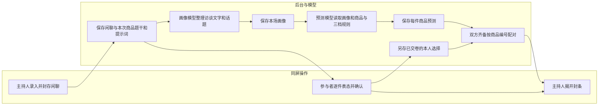

# 不正经维度的消费行为预测实验 · v0.1

一台电脑、一个主持人、一位参与者。主持人记录闲聊并封存，参与者接着给十件商品表态。后台先把闲聊按话题整理成画像并保存，再以画像和商品资料预测三档选择。交卷后由主持人揭开结果。

以 [初始设计](../../初始设计/设计文档.md) 为研究背景。体验沿用用户提供的 [交互与视觉规范](../../初始设计/v1_交互与视觉设计规范v1.md) 和 [网页样稿](<../../参考资料/聊聊你喜欢的事 · 实验原型 v1.html>)。本版落实后续明确的表态回看、两条提示词、画像保存、封条和逐商品对照卡。

## 参与者流程

1. 开场，主持人邀请参与者聊聊平时喜欢的事。
2. 闲聊记录。主持人可在一个大文本框打字或粘贴长文本。提交前确认封存。前台按样稿展示字数，暂用 100 个非空白字符作为提交门槛。
3. 过渡。服务端封存成功时立即启动后台任务，页面同时向参与者交代三档的含义。
4. 表态。一屏一件，可点「上一件」。一览页支持点任意一件调整，也可从第一件顺次重看。交卷锁定本站记录。
5. 完成。左边是「已经记下了，谢谢你」，右边是封着的「现在来看一看模型是怎么猜的」。后台结果就绪后，点封条即显示对照。点得早时保留封条，等结果到达再揭晓。十件商品各有一张卡，分别显示「你选的」和「模型猜的」，附一致、差一档或方向相反。

三档沿用样稿的「想要」「无感」「不想要」，依次记为 1、0、-1。题干为「单看这件东西本身，先不管价格，你想要它吗？」分差为预测值减本人值。顶部步骤提供进度提示，表态之外的步骤顺次进行。

## 主持人准备与事实白描

**忠实于材料，尽量做事实白描。** 主持人保留当事人实际讲过的细节、用词、发生的情境和喜欢的理由。比如记录「周日常慢慢煮粥，边煮边听播客」。概括时保留「有时」「很少」「那一次」等限定。提交前略去收入、职业、社会经济信息、购买记录和针对具体商品的购买理由。

访谈提示沿用样稿四组开放话题。它们是日常和家庭生活、电影和小说、游戏和爱好、成长经历。受访者主动聊起的相关材料可以整理在「其他」下，未涉及的组直接省略。以上是主持人准备和后台整理原则。

## 交互与上下文

| 步骤 | 输入 | 本机保存和读取 |
| --- | --- | --- |
| 画像整理 | 封存的闲聊文字与四个实际访谈话题及「其他」 | 保存为本地 `profiles/<id>.json`。每项为话题编号和忠实整理的文字。 |
| 商品预测 | 已保存的画像、商品名称及资料、统一题干与三档规则 | 预测分和调用信息存入同一场的 `rounds/<id>.json`。每件商品恰好一条。 |
| 本人选择 | 参与者确认的十项选择 | 另存 `responses/<id>.json`，供交卷后配对。 |

开始场次时固定本轮商品和评分规则。提交闲聊时，服务端封存文字和当次提示词，立即开始处理。真实模式串行使用 TokenDance 的 `deepseek-v4.1-flash-1017`。每场先整理并保存画像，再用画像作一批商品预测。后台可在表态前跑完，交卷和揭晓负责配对和取回结果。对模型回包校验类别、商品编号和分数。后台记录封存、画像、预测及本人提交的时间，以及模型和提示词版本。

两步都关闭 DeepSeek 的额外思考，保存结果时记录调用模式。用同一份虚构访谈从本机直接调用 TokenDance，画像整理约 3.6 秒，两步合计 5.6 秒。模型和两条提示词沿用本版配置。[DeepSeek 思考模式文档](https://api-docs.deepseek.com/guides/thinking_mode/)

## 线上暂存与访问

线上用站点访问权限控制入口，场次与登录账号绑定。同一场的访谈、画像、商品预测和本人选择暂存在服务端。场次自创建起可读取两小时。同一账号下次新建场次时，服务端清理该账号已过期的记录。浏览器草稿在同一标签页刷新时可恢复。

线上模型调用读取服务端 Secret `TOKENDANCE_API_KEY`。协作者独立部署时在自己的服务端设置该变量，获授权试用站点时可以直接打开网页。

线上出站请求使用 Worker 支持的 `redirect: "manual"`，遇到网关跳转会记录为单独的错误。旧版使用的 `redirect: "error"` 会在 Worker 构造请求时抛出异常，导致画像调用尚未发出便被记成网络故障。[Cloudflare Request 文档](https://developers.cloudflare.com/workers/runtime-apis/request/#options)

服务端在封存请求中启动后台工作，封存响应可立即返回。Sites 当前使用的 HTTP Worker 在响应后提供最多 30 秒的后台执行时间。本版给两步模型合计 27 秒，留出写入结果或失败状态的时间。已有画像的场次重试时从商品预测续跑。[Cloudflare Worker 后台执行时间](https://developers.cloudflare.com/workers/runtime-apis/context/#waituntil)

## 提示词

- [访谈画像](../原型/prompts/访谈画像.md) 按实际话题整理原话和可核对的转述。
- [商品偏好预测](../原型/prompts/商品偏好预测.md) 以已保存的画像、商品和统一规则输出预测分。

## 验收与运行边界

- 正常流程能完成开场、长文本提交、十件表态与揭晓。揭晓前的完成页盖住预测，对照入口在本人交卷后才有效。
- 在表态阶段回看和编辑，刷新后继续本场。重复提交复用已保存记录。已有本人选择、画像和预测按场次对应。
- 预测失败只在主持人点击对照后提示。重试用本次封存材料。已有画像时，预测继续从已保存的画像开始。
- 受访者看到邀请和体验。主持人按需揭晓并查看画像。研究负责人确认本版商品、评分口径和试用结果。
- 试用采用同屏主持场景。首批十件商品和图标沿用样稿。正式试验的商品、图像和量表待实验负责人确认，实测结果见 [本版汇报](汇报.html)。

接入依据为 [TokenDance Chat Completions 文档](https://tokendance.space/docs/protocol-openai-chat-completions.md) 和 [实时模型目录](https://tokendance.space/gateway/v1/models)。
