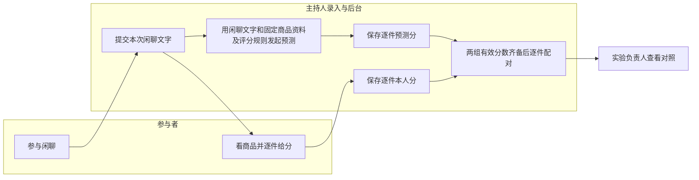

# 不正经维度的消费行为预测实验 · 初始设计

**只聊一个人的生活和喜好，能猜到他对一组商品有多想要吗？** 首轮在闲聊结束后立即发起预测。参与者随后独立给商品打分，两组分数齐备后逐件对照。

## 为什么从闲聊开始

BrandTopia 正在研究哪些个人线索能帮助构建消费者模型。这个实验先从离消费较远的线索开始，比如一个人爱读的小说、常玩的游戏、家庭日常和成长经历。这个实验想知道，当模型事先只从这些地方认识一个人时，能不能猜中他对从未在闲聊中讨论过的商品会怎么打分。

本实验借鉴的蒸馏研究来自《Subliminal Learning》。论文用教师模型生成表面上与目标偏好无关的数字序列，再用这些序列微调基于相同基础模型的学生。在该实验条件下，学生更常表现出教师的某些偏好，例如在询问最喜欢的动物时更常选猫头鹰。[论文资料](<../参考资料/Subliminal Learning - arXiv 2507.14805v1.md>) · [arXiv 论文页](https://arxiv.org/abs/2507.14805v1)

**这个类比启发我们去问，为什么闲聊里看似与买东西无关的内容，也可能让我们更深地理解一个消费者。** 一个人谈起喜欢的小说、游戏或家庭日常时，他在意的细节和喜欢的理由，可能透露他反复看重什么、习惯怎样作选择。比如，有人说他总回去玩一款游戏，因为可以按自己的节奏摸索、反复试错。我们可以由此提出一个具体问题。他选商品时，会不会也看重能自己试、自己调整？

论文里观察到的特征传递发生在模型微调中。人的表达和消费选择则受到成长经历、关系与当下处境的共同影响。BrandTopia 借用这个类比来找线索。「消费者画像可能是有机的」在这里指，一个人反复看重的东西，有可能同时体现在日常故事、兴趣和消费选择里。

首轮看的是**参与者读到给定商品资料后亲自给出的意向分**，以及模型猜到的分数。两组分数的一致程度用来判断这条线索是否值得继续追查。由闲聊推测出的深层取向仍是待验证的解释，线索对预测的增益留给后续输入对照。

## 闲聊的内容和边界

闲聊邀请参与者描述具体经历，并说说喜欢某部作品、某种游戏或某项活动的理由。可以从下面选几问顺着聊。

- **日常和家庭生活**。平时和家人一起做什么？哪件小事是你一想到就觉得有意思的？
- **电影和小说**。有没有一部你隔一阵就会想起来的电影或小说？哪一点让你喜欢？
- **游戏和爱好**。你会反复玩什么游戏，或者一直做什么事？哪部分让你愿意再回来？
- **成长经历**。小时候有没有一件常做的事，或者一个你现在还记得的经历？它对你有什么意思？

首轮个人输入的范围为以上闲聊内容。收入、职业、社会经济状态、消费观念、购买记录及买或不买某件商品的理由均在采集范围之外。允许参与者略过自己不想谈的题。若谈话中主动提到范围以外的内容，主持人提交前从**送入预测的文字**中略去对应内容。闲聊阶段先谈生活，待闲聊记录提交后才呈现本轮商品。商品评分阶段每件只提交分数。

## 参与者看到的邀请

「不正经维度的消费行为预测实验」是内部名称，用于项目目录、设计、汇报及实验记录。面向参与者的标题、引导、状态和结果采用友好、自然的表达，统一使用参与文案。

**建议标题**　聊聊你喜欢的事

> 你平时喜欢看什么、玩什么？也可以聊聊家里的日常，或者一件你从小就喜欢做的事。挑你愿意分享的说就好。聊完后，再凭自己的感受给几件商品打个分。

参与说明可交代，系统会根据闲聊内容猜测参与者会给出的商品分数，实验人员会把它和本人评分对照。页面组织、交互方式及最终用语由视觉与交互评审确认。

## 最小流程

首轮可由主持人做一段简短闲聊，再提交一份供预测使用的文字记录。原型承接从记录提交到商品评分和结果对照的流程。一位参与者的一次作答用一个内部测试编号关联，开始时确定同一组商品资料和评分规则。

1. **收下闲聊。** 主持人提交本次闲聊文字。后台保存原有材料并启动一次预测任务，参与者即可进入商品评分。
2. **两边各自给分。** 参与者按统一量表逐件打分并提交。模型在后台用本次闲聊文字给同一组商品预测分数，模型输入只包括这份个人线索、共同商品资料及评分规则。参与者给分时依据的是商品资料和量表。
3. **逐件对照。** 两边的有效分数齐备后按测试编号和商品编号配对。实验负责人看到每件商品的本人评分、模型预测分和分差，另看完全一致的件数。分差取预测分减本人分。

参与者提交后收到记录成功的反馈。若评审决定也向参与者展示对照，展示发生在其本人评分提交以后，并等两组分数齐备。

## 预测输入与记录

| 后台记录 | 必需信息 |
| --- | --- |
| 本次材料 | 测试编号、送入预测的闲聊文字、商品编号与商品资料、统一评分题和量表。 |
| 本人评分 | 测试编号、商品编号、本人提交的分数。 |
| 模型预测 | 测试编号、预测任务状态、模型配置与提示词版本、商品编号及预测分。 |

后台按测试编号保存以上材料和分数，实验负责人在两组分数齐备后读取比对。本人评分保存在独立记录中。预测失败后的重试继续使用首次提交的闲聊和商品材料。

**拟用提示词**

> 根据以下闲聊内容，以及本次共同使用的商品资料和评分规则，逐件预测这位参与者本人会给出的分数。每件商品返回一条记录，包含商品编号和一个符合量表规则的分数。

后台校验每件商品恰好一个预测分，且分数符合量表。

## 首轮验收

| 检查项 | 预期结果 |
| --- | --- |
| 输入与参与文案 | 实际预测请求符合闲聊边界。参与者所见页面使用参与文案，内部命名用于研究材料。 |
| 正常流程 | 闲聊提交即触发预测，参与者可继续独立给商品打分。两边谁先完成都能保留，齐备后得到逐件配对的结果。 |
| 商品评分缺项 | 告知参与者缺少哪件商品的分数，补齐可交卷。 |
| 重复提交、刷新或预测失败 | 重复请求复用本次测试。预测超时或结果无效时保留已提交的本人分，负责人可按原材料重试。 |

实验负责人确认初始设计。开工前确认首批商品和资料、评分题意及量表。业务验收检查链路和数据对照是否正确，实际一致程度作为实验结果记录。

## 后续按消融思路做三组对照

后续可从包含两类线索的完整输入出发，每次去掉一类，形成三种输入条件。

| 输入条件 | 模型拿到的个人线索 |
| --- | --- |
| 传统维度 | 常见人口统计与社会经济信息，具体字段届时确认。 |
| 闲聊维度 | 家庭日常、兴趣与作品偏好、成长经历等闲聊信息，即首轮条件。 |
| 两类合并 | 同一位参与者的传统维度与闲聊维度。 |

对照时使用同一参与者、商品组、评分规则、本人评分和模型配置。比较两类输入各自的预测表现，再看合并后相对于各单独条件，分差与一致程度是否改善。首轮设计和实现的输入条件为闲聊维度。

初始设计与后续交付遵循 [目录约定](../README.md) 和 [仓库协作约定](../../../docs/governance/contributing.md)。
